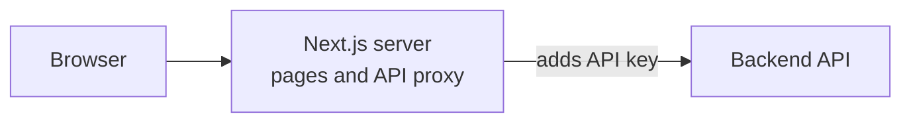

# Policy Analyzer: Frontend

[](https://nextjs.org/)
[](https://www.typescriptlang.org/)
[](https://tailwindcss.com/)
[](LICENSE)

The web app for the Policy Analyzer, a tool for exploring and comparing data protection and digital identity policy across Africa. It is built for policymakers, implementers and researchers.

- **Country maps and statistics**: data protection legislation and digital identity systems across African countries.
- **Chat**: questions answered from a collection of policy documents, plus batch analysis of question sets.
- **Sources**: reference documents and research for each country.
- **Documentation** (`/docs`): what the tool does, how it was built and produces results, and how to run or extend your own instance.

| Repository | Purpose |
| --- | --- |
| [policy-analyzer-frontend](https://github.com/cylab-africa/policy-analyzer-frontend) (this repo) | Next.js web app |
| [policy-analyzer-backend](https://github.com/cylab-africa/policy-analyzer-backend) | Backend API (required) |

## Contents

- [Architecture](#architecture)
- [Setup](#setup)
- [Configuration](#configuration)
- [Deployment](#deployment)
- [Project structure](#project-structure)
- [Editing the documentation page](#editing-the-documentation-page)
- [Troubleshooting](#troubleshooting)
- [License](#license)

---

## Architecture



- **The API key stays on the server.** The browser calls the website's `/api/...` route, which forwards only the backend routes the website uses.
- **The chat's conversation list is saved in the browser** (`localStorage`). The backend also records questions and answers.
- **Map shapes ship with the app** (`src/data/`). Country records come from the backend.
- **No analytics or tracking** is included.

---

## Setup

**Requirements:** Git, a running [backend](https://github.com/cylab-africa/policy-analyzer-backend#setup), and either [Node.js](https://nodejs.org/) 22 or newer, or Docker.

```bash
git clone https://github.com/cylab-africa/policy-analyzer-frontend.git
cd policy-analyzer-frontend
cp .env.example .env          # PowerShell: Copy-Item .env.example .env
```

In `.env`, set `BACKEND_API_KEY` to the same value as the backend's `API_KEY`. Then set `BACKEND_API_URL` for the option you choose:

| How you run the frontend | `BACKEND_API_URL` | Website address |
| --- | --- | --- |
| [Local development](#local-development) | `http://localhost:8000/api` (default) | <http://localhost:3000> |
| [Docker Compose](#docker-compose), with the backend in Compose on the same machine | `http://pdp-backend:8000/api` | <http://localhost:3001> |
| [Docker](#docker) | The backend's address as the container sees it, ending in `/api` | <http://localhost:3000> |

### Local development

```bash
npm install
npm run dev
```

| Command | Description |
| --- | --- |
| `npm run dev` | Development server with hot reload (Turbopack) |
| `npm run build` | Production build |
| `npm start` | Serve the production build on port 3000 |
| `npm run lint` | ESLint |

### Docker Compose

Start the backend first: its Compose project creates the `pdp-backend-network` network that the frontend joins.

```bash
docker compose up -d --build
```

### Docker

```bash
docker build -t policy-analyzer-frontend .
docker run -d --name policy-analyzer-frontend -p 3000:3000 --env-file .env policy-analyzer-frontend
```

Inside a container, `localhost` means the container itself. For a backend on the same machine, use `http://host.docker.internal:8000/api`. On Linux, also add `--add-host=host.docker.internal:host-gateway` to `docker run`; the backend must be reachable on that address.

---

## Configuration

| Variable | Required | Description | Example |
| --- | --- | --- | --- |
| `BACKEND_API_URL` | No | Backend API base URL, including `/api`. Defaults to `http://localhost:8000/api` | `http://localhost:8000/api` |
| `BACKEND_API_KEY` | Yes | Must match the backend's `API_KEY` | |

Both are server-side variables, read when the app starts. The browser never sees them: it calls the website's own `/api/...` route, and that route forwards the request to the backend with the key attached. For that reason the reverse proxy in front of the site must send `/api/` to this app, not to the backend. Do not give these variables a `NEXT_PUBLIC_` prefix, because that would send them to every visitor.

The proxy only forwards the backend routes the website uses, but it does not identify visitors: anyone who can load the site can use it. See the backend README's notes on [exposing an instance publicly](https://github.com/cylab-africa/policy-analyzer-backend#before-exposing-an-instance-publicly).

**Rate limits per visitor.** The proxy passes each visitor's address to the backend in an `X-Client-IP` header (taken from the last `X-Forwarded-For` entry, so run the site behind a reverse proxy that sets it). The backend believes that header only for requests from an address listed in its `TRUSTED_PROXY_IPS` setting, so set that to this server's address as the backend sees it. Until you do, every visitor shares one rate limit.

---

## Deployment

The Docker image is a multi-stage build that runs as a non-root user (`nextjs`, UID 1001) and serves on port `3000`. It runs on any container platform (a VM with Docker, Kubernetes, ECS, Cloud Run and others):

1. Build the image (see [Docker](#docker)). No secrets are needed at build time.
2. Push it to your container registry.
3. Run it with `BACKEND_API_URL` and `BACKEND_API_KEY` set, behind HTTPS, and route traffic to port 3000.
4. Make sure the backend accepts requests from the frontend's server. CORS no longer matters, because the browser only talks to the website itself.

Example Kubernetes container spec:

```yaml
containers:
  - name: frontend
    image: your-registry/policy-analyzer-frontend:latest
    ports:
      - containerPort: 3000
    env:
      - name: BACKEND_API_URL
        value: https://your-backend.example.org/api
      - name: BACKEND_API_KEY
        valueFrom:
          secretKeyRef: { name: policy-analyzer, key: backend-api-key }
    resources:
      requests: { memory: "256Mi", cpu: "100m" }
      limits: { memory: "512Mi", cpu: "500m" }
```

Without Docker: `npm ci && npm run build && npm start`, with `BACKEND_API_URL` and `BACKEND_API_KEY` set in the environment when you start the app.

### Updating a deployed frontend

- **Configuration is read at start-up.** Docker ignores `.env` files (see `.dockerignore`), so pass `BACKEND_API_URL` and `BACKEND_API_KEY` with `-e` (or `--env-file` pointing at a file outside the repository) when you start the container. Changing them does not need a rebuild.

- **Building an image does not change a running container.** Remove the old container and start a new one from the new image.
- **Behind a reverse proxy in Docker?** If the proxy reaches the frontend by name, start the new container with the same `--name` and on the same Docker network (`--network <proxy network>`), then restart the proxy. A container started without the network flag works on its own but the proxy cannot reach it, and the site shows `502`.
- **Keep the previous image** (note its ID with `docker ps`) until the new one is confirmed working, so you can roll back. Do not run `docker image prune` before then.
- **Changing the API key?** Follow [Rotating the API key](https://github.com/cylab-africa/policy-analyzer-backend#rotating-the-api-key) in the backend README, because both sides must change together.
- **`permission denied` on the Docker socket?** Run the Docker commands with `sudo`, or add your user to the `docker` group.

---

## Project structure

```
├── src/
│   ├── app/           # Pages (App Router): /, /chat, /sources, /docs, and the API proxy
│   ├── components/    # UI components by feature (home, chat, resources, docs, layout, ui)
│   ├── data/          # Static map geometry and data
│   ├── lib/           # Utilities
│   ├── redux/         # API client (RTK Query) and store
│   └── types/         # TypeScript types
├── public/            # Static assets
├── docs/              # Requirements and user stories
└── Dockerfile
```

Further reading: [functional requirements](./docs/functional-requirements.md), [non-functional requirements](./docs/nonfunctional-req.md) and [user stories](./docs/user-story.md).

---

## Editing the documentation page

The `/docs` page is built from components in [`src/components/docs/`](src/components/docs/), with one file per section in `sections/`. Section and sub-section titles are defined once in [`meta.ts`](src/components/docs/meta.ts), and the table of contents and in-page links are built from them. To add a section, add its titles to `meta.ts`, create the component, and list it in `sections/index.ts`. Shared building blocks (`DocSection`, `DocSubsection`, `P`, `UL`, `DocTable` and others) are in `primitives.tsx`.

---

## Troubleshooting

| Problem | Fix |
| --- | --- |
| Maps and Sources are empty | Check the backend is running and its reference data is loaded ([backend setup](https://github.com/cylab-africa/policy-analyzer-backend#setup)) |
| `401`/`403` errors in the browser console | `BACKEND_API_KEY` doesn't match the backend's `API_KEY` |
| Changed `.env` but nothing happened | Restart `npm run dev`. For Docker, `.env` is ignored: pass the values with `-e` when you start the container ([Updating a deployed frontend](#updating-a-deployed-frontend)) |
| `502 Bad Gateway` after replacing the container | The new container is not on the proxy's Docker network or has a different name. Start it with the same `--name` and `--network` as before, then restart the proxy |
| `npm install` reports `ERESOLVE` | Make sure `.npmrc` (with `legacy-peer-deps=true`) is present; `react-simple-maps` declares peer support only up to React 18 |
| `500` or `502` from `/api/...` | `BACKEND_API_KEY` is not set (500), or the website's server cannot reach `BACKEND_API_URL` (502). In Docker, `localhost` is the container itself |

---

## License

Released under the [MIT License](LICENSE).

## Contributing

Issues and pull requests are welcome. Please read [CONTRIBUTING.md](CONTRIBUTING.md) first, and note that everyone taking part is expected to follow the [Code of Conduct](CODE_OF_CONDUCT.md). To report a security problem, follow [SECURITY.md](SECURITY.md) instead of opening a public issue. If you use this software in your work, see [CITATION.cff](CITATION.cff).
