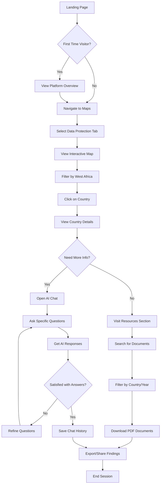
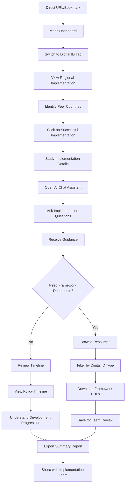
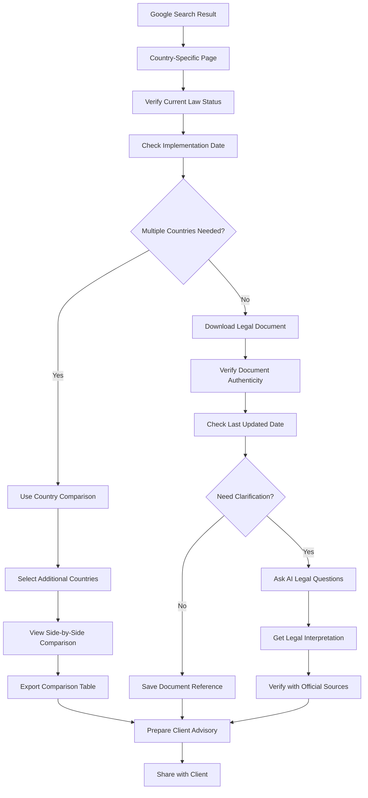
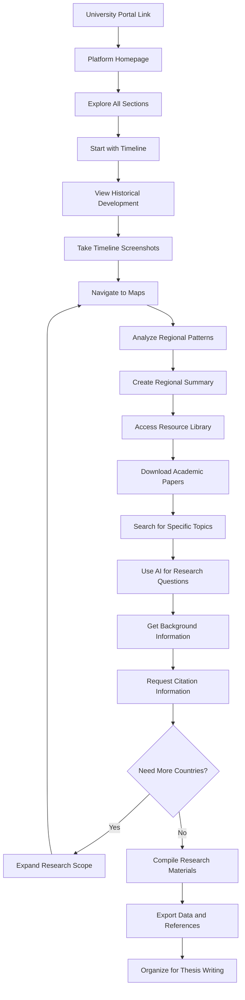
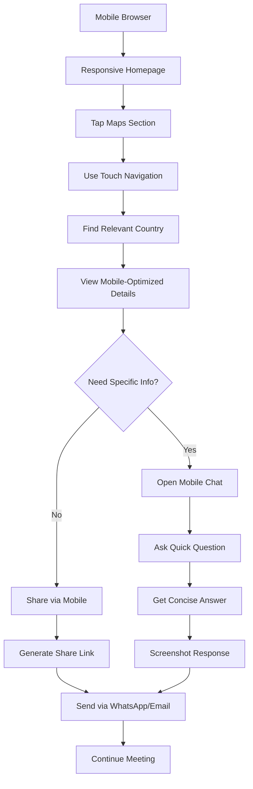

# User Flow Documentation

## Overview

This document outlines the key user flows for the African Policy & Digital Identity Platform, showing how different user types navigate through the application to accomplish their goals.

---

## Flow 1: Policy Research Journey

### Primary Actor: Policy Researcher

### Goal: Research data protection laws across West African countries

### Step-by-Step Flow

#### 1. Entry Point (Landing Page)

-   **User arrives at**: Homepage with hero section and overview
-   **Key elements visible**: Navigation menu, main call-to-action, feature highlights
-   **User action**: Clicks "Explore Maps" or navigates via menu

#### 2. Map Exploration

-   **User lands on**: Maps section with default Data Protection view
-   **Available actions**:
    -   Switch between Data Protection and Digital ID tabs
    -   Apply regional filters
    -   Hover over countries for quick info
    -   Click countries for detailed view
-   **User goal**: Identify West African countries with data protection laws

#### 3. Country Deep Dive

-   **Trigger**: Click on specific country (e.g., Nigeria)
-   **User sees**:
    -   Country-specific policy information
    -   Implementation timeline
    -   Related documents
    -   Comparison with neighboring countries
-   **Available actions**: View documents, ask AI questions, share information

#### 4. AI-Assisted Research

-   **Entry point**: "Ask AI" button from country page or navigation
-   **User experience**:
    -   Select appropriate chat context (Data Protection)
    -   Type specific questions about Nigerian data protection law
    -   Receive contextual responses with references
    -   Follow up with related questions
-   **Value delivered**: Quick answers without manual document searching

#### 5. Document Access

-   **Trigger**: Need for official documents
-   **User journey**:
    -   Navigate to Resources section
    -   Use search and filters to find relevant documents
    -   Preview document details
    -   Download or view in browser
-   **Outcome**: Access to primary source materials

---

## Flow 2: Government Implementation Guidance

### Primary Actor: Government Official

### Goal: Understand digital ID implementation requirements and best practices

### Step-by-Step Flow

#### 1. Direct Access

-   **Entry method**: Bookmarked URL or direct link from colleague
-   **Landing page**: Maps dashboard (returning user behavior)
-   **Immediate focus**: Digital ID implementation status

#### 2. Regional Analysis

-   **User action**: Switch to Digital ID tab
-   **Analysis approach**:
    -   Filter by region (e.g., East Africa)
    -   Compare implementation levels
    -   Identify successful peer countries
    -   Note implementation patterns
-   **Goal**: Benchmark against similar countries

#### 3. Success Case Study

-   **Selection criteria**: Countries with "Implemented" status
-   **Deep dive approach**:
    -   Click on successful country (e.g., Rwanda)
    -   Review implementation timeline
    -   Study authority structure
    -   Analyze coverage statistics
-   **Learning objective**: Extract best practices

#### 4. Expert Consultation (AI)

-   **Trigger**: Need for specific implementation guidance
-   **Query examples**:
    -   "What legal framework is needed for biometric ID?"
    -   "How did Kenya handle privacy concerns in Huduma Namba?"
    -   "What are common implementation challenges?"
-   **Value**: Immediate expert-level guidance

#### 5. Framework Research

-   **Purpose**: Obtain official documents for policy development
-   **Search strategy**:
    -   Filter by document type (National ID, Registration)
    -   Focus on recent implementations (2018+)
    -   Download multiple frameworks for comparison
-   **Outcome**: Comprehensive policy toolkit

---

## Flow 3: Legal Research and Compliance

### Primary Actor: Legal Professional

### Goal: Verify compliance requirements for multinational client

### Step-by-Step Flow

#### 1. Search Engine Entry

-   **Discovery**: Google search for "Kenya data protection law"
-   **Landing**: Specific country page or resource document
-   **Validation**: Verify information currency and authenticity

#### 2. Compliance Verification

-   **Process**:
    -   Check law enactment status
    -   Verify implementation dates
    -   Review key requirements
    -   Assess penalties and enforcement
-   **Documentation**: Screenshot or bookmark key information

#### 3. Multi-Jurisdiction Analysis

-   **Trigger**: Client operates in multiple African countries
-   **Approach**:
    -   Use comparison tool for 3-5 countries
    -   Focus on data transfer requirements
    -   Identify conflicting provisions
    -   Note implementation variations
-   **Output**: Comprehensive compliance matrix

#### 4. Document Authentication

-   **Verification steps**:
    -   Check official government links
    -   Verify document publication dates
    -   Cross-reference with multiple sources
    -   Note any unofficial translations
-   **Risk mitigation**: Ensure legal advice based on authentic sources

#### 5. Expert Clarification

-   **Use case**: Complex legal interpretations needed
-   **AI consultation**:
    -   Ask about specific legal provisions
    -   Seek clarification on enforcement practices
    -   Request comparative analysis
-   **Follow-up**: Verify AI responses with official sources

---

## Flow 4: Academic Research Project

### Primary Actor: Graduate Student

### Goal: Complete thesis research on African digital rights evolution

### Step-by-Step Flow

#### 1. Academic Discovery

-   **Entry point**: University library portal or professor recommendation
-   **First impression**: Assess platform credibility and scope
-   **Decision**: Determine if platform meets research needs

#### 2. Historical Context Building

-   **Starting point**: Policy Timeline section
-   **Research approach**:
    -   Screenshot key milestones
    -   Note development patterns
    -   Identify policy turning points
    -   Track international influence
-   **Academic value**: Chronological framework for thesis

#### 3. Geographic Analysis

-   **Method**: Interactive map exploration
-   **Analysis dimensions**:
    -   Regional adoption patterns
    -   Economic development correlation
    -   Colonial history influence
    -   Current implementation gaps
-   **Documentation**: Regional summary tables

#### 4. Primary Source Collection

-   **Resource strategy**:
    -   Download official legislation texts
    -   Collect government framework documents
    -   Gather implementation guidelines
    -   Archive web page versions
-   **Organization**: Create bibliography with proper citations

#### 5. Knowledge Gap Identification

-   **AI consultation**: Ask research questions to identify gaps
-   **Query examples**:
    -   "What factors influenced Kenya's early adoption?"
    -   "How do francophone countries differ in approach?"
    -   "What role did international organizations play?"
-   **Research expansion**: Use AI insights to guide additional research

---

## Flow 5: Mobile Quick Reference

### Primary Actor: Government Official (Field Work)

### Goal: Quick policy information during stakeholder meeting

### Step-by-Step Flow

#### 1. Mobile Access

-   **Context**: In meeting, need quick policy reference
-   **Constraints**: Limited time, potentially poor connection
-   **Approach**: Direct navigation to needed information

#### 2. Touch-Optimized Navigation

-   **Interaction**: Finger-friendly map controls
-   **Performance**: Fast loading of essential information
-   **Display**: Mobile-optimized layouts and readable text

#### 3. Quick Information Access

-   **Priority**: Key facts and figures
-   **Format**: Easily digestible mobile content
-   **Actions**: Screenshot or bookmark for later reference

#### 4. Instant Sharing

-   **Method**: Platform-generated shareable links
-   **Channels**: WhatsApp, email, Slack integration
-   **Content**: Formatted for easy consumption by recipients

---

## Cross-Flow Considerations

### Common Entry Points

1. **Direct URL**: Bookmarked or shared links
2. **Search engines**: Google results for specific countries/topics
3. **Social media**: Shared content from other users
4. **Academic portals**: University library systems
5. **Professional networks**: LinkedIn or policy forums

### Common Exit Points

1. **Document downloads**: PDF legislation or frameworks
2. **External links**: Official government websites
3. **Social sharing**: Shared content to colleagues
4. **Bookmarking**: Saved for future reference
5. **Task completion**: Research objectives met

### Navigation Patterns

-   **Hub and spoke**: Central dashboard with feature access
-   **Linear progression**: Step-by-step research workflows
-   **Exploratory browsing**: Discovery-driven navigation
-   **Task-focused**: Direct path to specific information

### Error Recovery Flows

-   **No results found**: Suggested alternatives and broader searches
-   **Broken links**: Alternative sources and updated information
-   **Technical issues**: Graceful degradation and retry options
-   **User confusion**: Help tooltips and guided tours

---

## Success Metrics by Flow

### Research Flow Success

-   Time to find relevant country information < 2 minutes
-   Successful document downloads > 80%
-   Chat interactions leading to satisfaction > 85%

### Implementation Flow Success

-   Framework document access < 30 seconds
-   Peer country comparison completion > 70%
-   AI guidance rated helpful > 90%

### Legal Flow Success

-   Document authenticity verification < 1 minute
-   Multi-country comparison completion > 75%
-   Legal question resolution success > 85%

### Academic Flow Success

-   Historical timeline exploration completion > 90%
-   Resource collection success rate > 85%
-   Research question answered rate > 80%

### Mobile Flow Success

-   Mobile task completion < 1 minute
-   Share action success rate > 95%
-   Mobile user satisfaction > 85%
